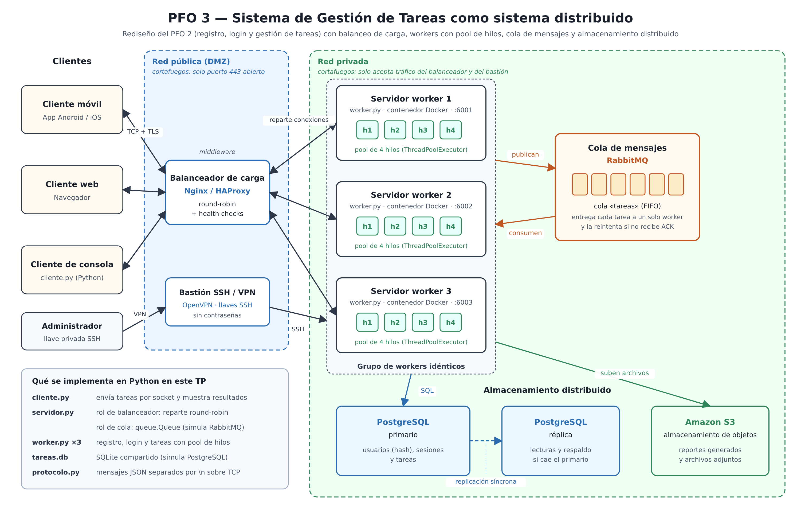

# PFO 3: Rediseño como Sistema Distribuido (Cliente-Servidor)

## 🎯 Objetivo

Transformar el **Sistema de Gestión de Tareas del PFO 2** en una **arquitectura distribuida usando sockets**.

* ✅ Diagrama del sistema con clientes, balanceador de carga, workers con pool de hilos,
  cola de mensajes y almacenamiento distribuido.
* ✅ Servidor en Python que recibe tareas por socket y las distribuye a workers.
* ✅ Cliente en Python que envía tareas y recibe resultados.

### Del PFO 2 al PFO 3

| PFO 2 | PFO 3 (rediseño distribuido) |
| --- | --- |
| Un único servidor Flask | Un servidor de entrada que reparte el trabajo entre **3 workers** |
| API REST sobre HTTP | Mensajes JSON sobre **sockets TCP** |
| `POST /registro`, `POST /login`, `GET /tareas` | Operaciones `registro`, `login`, `crear_tarea`, `listar_tareas`, `completar_tarea` y `generar_reporte` |
| Autenticación básica en cada pedido | **Token de sesión** guardado en la base, válido en cualquier worker |
| Si el servidor se cae, el sistema deja de funcionar | Si un worker se cae, los demás siguen atendiendo |

Se mantienen las buenas prácticas del PFO 2: **contraseñas hasheadas** (Werkzeug), **consultas
parametrizadas** contra la inyección SQL y el mismo mensaje de error si el usuario no existe o la
contraseña es incorrecta.

---

## 🗺️ Diagrama del sistema



### Componentes

| Componente | Tecnología | Función |
| --- | --- | --- |
| **Clientes** | App móvil, navegador web, consola Python | Envían pedidos (registrarse, iniciar sesión, gestionar tareas) y reciben los resultados |
| **Balanceador de carga** | Nginx / HAProxy | Funciona como *middleware*: es el único punto de entrada. Reparte las conexiones entre los workers (round-robin) y deja de enviarles tráfico a los que no responden (*health checks*) |
| **Servidores workers** | Python + pool de hilos, en contenedores Docker | Todos son copias idénticas del mismo programa. Cada uno atiende varios pedidos a la vez con una cantidad fija de hilos reutilizables. Al estar aislado en su propio contenedor, una falla o vulnerabilidad en un worker no afecta a los demás |
| **Cola de mensajes** | RabbitMQ | Comunica a los servidores entre sí: los workers publican tareas pesadas (como los reportes) y las consume el que tenga capacidad libre. Si un worker se cae antes de confirmar (ACK), la tarea se entrega a otro |
| **Base de datos** | PostgreSQL (primario + réplica) | Guarda usuarios (con la contraseña hasheada), sesiones y tareas. La réplica sincrónica permite seguir operando si el primario falla |
| **Almacenamiento de objetos** | Amazon S3 | Guarda los reportes generados y los archivos adjuntos |
| **Bastión SSH / VPN** | OpenVPN + llaves SSH | Única puerta de entrada para administrar los servidores de la red privada |

### Recorrido de un pedido

1. El cliente envía el pedido por una conexión **TCP cifrada con TLS** al balanceador.
2. El balanceador elige un worker disponible y le reenvía la conexión.
3. El worker asigna el pedido a uno de los hilos libres de su pool.
4. Si es una tarea pesada (un reporte), el worker la **publica en RabbitMQ** y otro worker con capacidad libre la consume.
5. Los datos se leen y guardan en **PostgreSQL**, y los reportes en **S3**.
6. La respuesta vuelve al cliente por el mismo camino.

### Por qué los datos y las sesiones van en una base compartida

En un sistema distribuido, **cualquier worker puede atender cualquier pedido**. Por ejemplo, el login
lo puede resolver el worker 1 y la creación de una tarea, segundos después, el worker 2. Si cada
worker guardara los usuarios o las sesiones en su propia memoria, el worker 2 no reconocería al
usuario que inició sesión en el worker 1.

Por eso los workers **no guardan estado propio**: los usuarios, las tareas y los **tokens de sesión**
están en la base de datos que comparten todos. Así se pueden agregar o quitar workers sin que los
usuarios lo noten (escalabilidad horizontal).

### Seguridad por capas

El sistema separa dos redes:

* **Red pública (DMZ):** solo el balanceador está expuesto a Internet. El **cortafuegos** deja abierto
  únicamente el puerto 443 (servicio público).
* **Red privada:** workers, cola de mensajes y bases de datos no son accesibles desde afuera. El
  cortafuegos solo acepta tráfico del balanceador y del bastión (servicios privados e internos).
* **Administración:** para entrar a los servidores privados hay que conectarse primero a la **VPN**
  (OpenVPN) y después usar **llaves SSH**, sin contraseñas. Así se evitan los ataques de fuerza bruta.
* **Cifrado:** los datos viajan cifrados con **TLS** entre el cliente y el balanceador. Los
  certificados se gestionan con una **PKI**.
* **Aislamiento:** cada worker corre en su propio **contenedor Docker**, para que un servicio
  comprometido no afecte al resto.

---

## 💻 Implementación en Python

El código es un **prototipo local** de la arquitectura del diagrama. No hace falta instalar RabbitMQ,
Nginx ni PostgreSQL: se reemplazan por equivalentes simples que corren en la misma máquina.

| Archivo | Qué representa del diagrama |
| --- | --- |
| `servidor.py` | Punto de entrada (puerto 5000). Cumple el rol del **balanceador** (reparte round-robin entre workers y saltea los que no responden) y de la **cola de mensajes** (`queue.Queue` reemplaza a RabbitMQ) |
| `worker.py` | Un **servidor worker** con su **pool de 4 hilos** (`ThreadPoolExecutor`). Resuelve el registro, el login y la gestión de tareas. Se ejecutan tres, en los puertos 6001, 6002 y 6003 |
| `tareas.db` | Base **SQLite compartida** por los tres workers (reemplaza a PostgreSQL). Se crea automáticamente |
| `cliente.py` | **Cliente de consola** con menú: envía los pedidos por socket y muestra el resultado y qué worker lo resolvió |
| `protocolo.py` | Formato de los mensajes, compartido por los tres programas |
| `diagrama/` | Diagrama del sistema en PNG y SVG |

### Cómo funciona el servidor

```text
 cliente ──► hilo de atención ──► cola_tareas ──► despachadores ──► worker 1 / 2 / 3 ──► tareas.db
   ▲          (uno por cliente)   (queue.Queue)   (12 hilos que       (pool de 4 hilos     (compartida)
   │                                               consumen la cola)    cada uno)
   └──────────────────────────── resultado ◄────────────────────────────────┘
```

1. Por cada cliente que se conecta se crea un **hilo de atención**.
2. Cada pedido recibido se **publica en la cola** junto con una "cola de respuesta" propia, para que el
   resultado vuelva al cliente correcto.
3. Los **despachadores** consumen la cola y envían cada pedido al próximo worker en orden rotativo.
4. Si un worker no responde, el despachador **prueba con el siguiente** (tolerancia a fallos).

### Protocolo de mensajes

TCP es un flujo continuo de bytes y no marca dónde termina cada mensaje. Por eso cada mensaje es un
JSON en una sola línea terminada en `\n`:

```text
cliente  → servidor:  {"tipo": "login", "datos": {"usuario": "xime", "contraseña": "1234"}}
servidor → worker:    {"id": 4, "tipo": "login", "datos": {"usuario": "xime", "contraseña": "1234"}}
worker   → cliente:   {"id": 4, "estado": "ok", "resultado": {"mensaje": "Inicio de sesión exitoso...", "token": "9f2c..."}, "worker": "worker-1", "hilo": "worker-1-hilo_0"}
```

### Operaciones disponibles

| Tipo | Datos | Resultado |
| --- | --- | --- |
| `registro` | `usuario`, `contraseña` | Crea el usuario con la contraseña hasheada |
| `login` | `usuario`, `contraseña` | Verifica las credenciales y devuelve un **token de sesión** |
| `crear_tarea` | `token`, `titulo` | Crea una tarea para el usuario |
| `listar_tareas` | `token` | Lista las tareas del usuario |
| `completar_tarea` | `token`, `id_tarea` | Marca una tarea propia como completada |
| `generar_reporte` | `token` | Resumen de tareas totales, completadas y pendientes. Tarda unos 2 segundos para simular una tarea pesada |

---

## 🧪 Ejecución

Requiere **Python 3.8 o superior** y la librería Werkzeug:

```bash
pip install -r requirements.txt
```

Se usan **5 terminales**, todas abiertas en la carpeta del proyecto.

**1. Iniciar los tres workers (una terminal para cada uno):**

```bash
python worker.py 1
python worker.py 2
python worker.py 3
```

Cada uno muestra: `worker-1 escuchando en 127.0.0.1:6001 con 4 hilos`

**2. Iniciar el servidor (cuarta terminal):**

```bash
python servidor.py
```

```text
Servidor escuchando en 127.0.0.1:5000
12 despachadores esperando tareas en la cola
Workers configurados: 127.0.0.1:6001, 127.0.0.1:6002, 127.0.0.1:6003
```

**3. Iniciar el cliente (quinta terminal):**

```bash
python cliente.py
```

```text
===== Sistema Distribuido de Gestión de Tareas (sin sesión) =====
1. Registrarse
2. Iniciar sesión
3. Crear tarea
4. Ver mis tareas
5. Completar tarea
6. Generar reporte
7. Pedir 6 reportes en paralelo (prueba de distribución)
8. Salir
```

### Pruebas sugeridas

**Uso normal y distribución.** Registrarse, iniciar sesión, crear algunas tareas, verlas y completar
una. Debajo de cada resultado se ve qué worker lo resolvió: los pedidos se reparten entre los tres
(worker-1, worker-2, worker-3, worker-1...). Por ejemplo, el login lo resuelve un worker y la tarea la
crea otro, y la sesión sigue siendo válida porque está guardada en la base compartida.

```text
  OK: Inicio de sesión exitoso. Bienvenido/a, xime
  (resuelta por worker-1, worker-1-hilo_0)
  OK: Tarea #1 creada: Estudiar para el parcial
  (resuelta por worker-2, worker-2-hilo_0)
```

**Trabajo en paralelo.** La opción 7 pide 6 reportes al mismo tiempo, desde 6 conexiones distintas.
Cada reporte tarda 2 segundos, pero terminan en unos **2 segundos** en lugar de 12, porque se
reparten entre los workers y los hilos de cada pool.

```text
  Tarea 12 resuelta por worker-3 (worker-3-hilo_0)
  Tarea 13 resuelta por worker-1 (worker-1-hilo_0)
  ...
Tiempo total: 2.0 segundos (en forma secuencial habría tardado 12 segundos)
```

**Tolerancia a fallos.** Detener un worker y seguir usando el cliente: el servidor
avisa que ese worker no está disponible y reparte los pedidos entre los que siguen funcionando. Las
tareas y la sesión no se pierden, porque están en la base compartida.

**Manejo de errores.**
* Registrar un usuario que ya existe: *"El usuario ya existe"*.
* Iniciar sesión con una contraseña incorrecta: *"Credenciales inválidas"*.
* Completar una tarea que no existe: *"No existe la tarea #99 entre tus tareas"*.
* Ejecutar el cliente sin el servidor: reintenta la conexión 3 veces antes de rendirse.
* Detener todos los workers: el servidor responde *"No hay workers disponibles"*.


---

## 💡 Diferencias entre el prototipo y el diseño completo

| En el diseño | En el prototipo |
| --- | --- |
| Nginx / HAProxy | Reparto round-robin dentro de `servidor.py` |
| RabbitMQ | `queue.Queue` de Python |
| PostgreSQL | Archivo SQLite `tareas.db` compartido por los workers |
| Amazon S3 | No se implementa (el reporte se devuelve al cliente) |
| TLS | Conexión TCP sin cifrar (todo corre en `127.0.0.1`) |
| Workers en distintas máquinas | Workers en distintos procesos de la misma máquina |
| Contenedores Docker, cortafuegos, VPN y SSH | No se implementan (son configuración de infraestructura, no código) |

